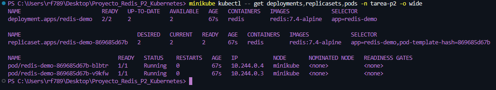
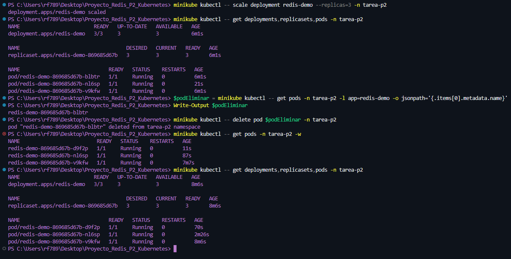

# Redis en Kubernetes: Deployment y ReplicaSet (P2)

## Descripción

Práctica individual realizada en un clúster local de **Kubernetes** con **Minikube y Docker Desktop**. Se desplegó **Redis** para comprobar cómo funcionan los recursos **Deployment** y **ReplicaSet**, cómo se aumenta el número de Pods y qué sucede cuando se elimina uno de ellos.

## Objetivo

Configurar Redis en Kubernetes y demostrar el funcionamiento de Deployment y ReplicaSet mediante la creación de dos Pods, pruebas básicas de Redis, escalado a tres réplicas y recuperación automática de un Pod.

## Herramientas utilizadas

- **Docker Desktop:** motor de contenedores.
- **Minikube:** clúster local de Kubernetes.
- **PowerShell:** ejecución de los comandos.
- **Visual Studio Code:** revisión de los archivos YAML.
- **Redis:** imagen `redis:7.4-alpine`.
- **Git y GitHub:** publicación del proyecto.

## Archivos del proyecto

```text
kubernetes-redis-deployment-replicaset/
├── k8s/
│   ├── namespace.yaml
│   └── redis-deployment.yaml
├── evidencias/
│   └── [capturas de la práctica]
└── README.md
```

El archivo `namespace.yaml` crea el espacio de trabajo `tarea-p2`. El archivo `redis-deployment.yaml` define el Deployment `redis-demo` con **dos réplicas** de Redis y comprobaciones de salud.

> **Nota:** el ReplicaSet fue creado automáticamente por Kubernetes a partir del Deployment; no se configuró un ReplicaSet independiente.

## Procedimiento realizado

### 1. Iniciar y comprobar el clúster

Con Docker Desktop en ejecución, se utilizaron los siguientes comandos:

```powershell
minikube start --driver=docker
minikube status
minikube kubectl -- get nodes
```

El clúster inició correctamente y el nodo `minikube` apareció en estado **Ready**.

### 2. Crear el Namespace y el Deployment

```powershell
minikube kubectl -- apply -f k8s/namespace.yaml
minikube kubectl -- apply -f k8s/redis-deployment.yaml
minikube kubectl -- rollout status deployment/redis-demo -n tarea-p2 --timeout=180s
minikube kubectl -- get deployments,replicasets,pods -n tarea-p2 -o wide
```

Kubernetes creó el **Deployment**, el **ReplicaSet** y **dos Pods**, ambos en estado `Running` y `1/1`.

### 3. Comprobar Redis

Se seleccionó uno de los Pods y se ejecutaron tres operaciones básicas:

```powershell
$pod = minikube kubectl -- get pods -n tarea-p2 -l app=redis-demo -o jsonpath='{.items[0].metadata.name}'
minikube kubectl -- exec -n tarea-p2 $pod -- redis-cli PING
minikube kubectl -- exec -n tarea-p2 $pod -- redis-cli SET materia "DevOps-P2"
minikube kubectl -- exec -n tarea-p2 $pod -- redis-cli GET materia
```

Los resultados fueron **`PONG`**, **`OK`** y **`DevOps-P2`**. Así se comprobó que Redis respondía y permitía guardar y consultar un dato.

### 4. Aumentar las réplicas y eliminar un Pod

```powershell
minikube kubectl -- scale deployment redis-demo --replicas=3 -n tarea-p2
minikube kubectl -- get deployments,replicasets,pods -n tarea-p2
$podEliminar = minikube kubectl -- get pods -n tarea-p2 -l app=redis-demo -o jsonpath='{.items[0].metadata.name}'
minikube kubectl -- delete pod $podEliminar -n tarea-p2
minikube kubectl -- get pods -n tarea-p2 -w
```

El Deployment pasó de **2 a 3 réplicas**. Al eliminar uno de los Pods, Kubernetes creó otro automáticamente y volvió a mantener **3 Pods**.

### 5. Volver al estado inicial

```powershell
minikube kubectl -- scale deployment redis-demo --replicas=2 -n tarea-p2
minikube kubectl -- get deployments,replicasets,pods -n tarea-p2
```

Al terminar la práctica, el Deployment volvió a tener **2/2 réplicas disponibles**.

## Evidencias

Las capturas muestran los resultados reales obtenidos en PowerShell. Los archivos se encuentran en la carpeta [`evidencias/`](evidencias/).

| Evidencia | Descripción |
|---|---|
| [01. Inicio de Minikube](evidencias/01_inicio_minikube.png) | Inicio del clúster y comprobación de sus componentes. |
| [02. Nodo Ready](evidencias/02_nodo_ready.png) | Kubernetes reconoce el nodo local y muestra su estado `Ready`. |
| [03. Namespace](evidencias/03_namespace.png) | Creación del espacio de trabajo `tarea-p2`. |
| [04. Deployment](evidencias/04_deployment.png) | Creación del Deployment `redis-demo`. |
| [05. Estado del despliegue](evidencias/05_rollout.png) | Confirmación de que el despliegue finalizó correctamente. |
| [06. Deployment, ReplicaSet y Pods](evidencias/06_replicaset_pods.png) | Dos Pods de Redis disponibles y en ejecución. |
| [07. Pruebas de Redis](evidencias/07_pruebas_redis.png) | Resultados de `PING`, `SET` y `GET`. |
| [08. Escalado y recuperación](evidencias/08_escalado_recuperacion.png) | Escalado a tres réplicas y reemplazo automático de un Pod eliminado. |
| [09. Regreso a dos réplicas](evidencias/09_retorno_dos_replicas.png) | Reducción del Deployment a dos Pods. |
| [10. Estado final](evidencias/10_estado_final.png) | Verificación final de las dos réplicas disponibles. |

### Evidencia principal: Deployment y ReplicaSet



### Evidencia principal: escalado y recuperación



## ¿Para qué sirve Redis?

Redis puede utilizarse para **caché**, almacenamiento temporal de **sesiones**, **contadores** y consulta rápida de determinados datos. En esta práctica se probó su funcionamiento básico con `PING`, `SET` y `GET`.

## Alcance de la práctica

Las réplicas creadas son **Pods independientes con Redis**. El ejercicio demuestra la administración y recuperación de Pods en Kubernetes, **no** la replicación de datos de Redis. No se configuró almacenamiento persistente ni una infraestructura para producción.

## Conclusión

La práctica permitió comprobar que **Deployment** declara cuántas copias de una aplicación deben ejecutarse y que **ReplicaSet** ayuda a mantener esa cantidad. También se verificó el funcionamiento de Redis y la creación automática de un Pod nuevo cuando se eliminó uno de los existentes.

## Referencias

- [Kubernetes: Deployments](https://kubernetes.io/docs/concepts/workloads/controllers/deployment/)
- [Kubernetes: ReplicaSet](https://kubernetes.io/docs/concepts/workloads/controllers/replicaset/)
- [Minikube: documentación oficial](https://minikube.sigs.k8s.io/docs/start/)
- [Redis: documentación oficial](https://redis.io/docs/latest/)
